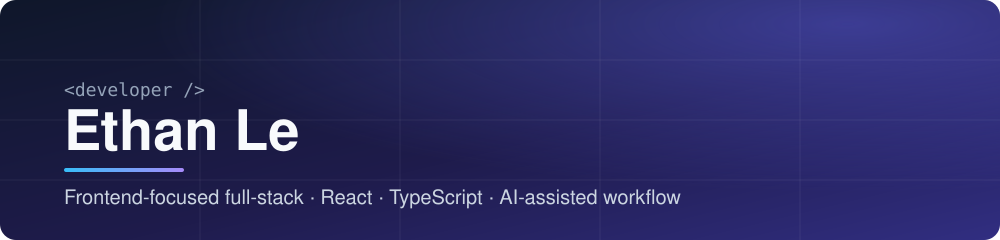

 

Frontend-focused full-stack developer with 5 years in IT. Previously outsourced on a US book-community platform, now working on product teams with React, TypeScript, and Next.js.

### 🔭 Now
- Building a self-hosted Vietnamese/English text-to-speech service
- Building a local-first personal finance app for iPhone

### 🤖 AI engineering workflow
I treat the coding agent as a system to engineer, not a chat box. The goal: less manual glue, more automation, and an agent that already knows my context.

| Layer | What I set up |
|---|---|
| **Harness** | Terminal coding agent with custom rules, ~20 reusable skills (TDD, debugging, code review, planning) and role-based subagents that run in parallel with isolated context |
| **Context** | Persistent memory and project rules, so every session starts with my conventions, constraints, and lessons from earlier work; new lessons get captured and reused |
| **Integrations** | MCP servers for GitHub, Linear, Sentry, and Slack, so tickets, PRs, errors, and messages are reachable from the same session |
| **Guardrails** | Explicit rules for git safety, resource limits, and verification before anything counts as done |
| **Automation** | Personal tools built on LLM APIs, e.g. an assistant that analyzes Linear tickets |

### 🧰 Stack

<table>
<tr>
<td><b>Frontend</b></td>
<td>
<picture>
  <source media="(prefers-color-scheme: light)" srcset="https://skillicons.dev/icons?i=ts,js,react,nextjs,html,css,sass,tailwind&theme=light" />
  
</picture>
</td>
</tr>
<tr>
<td><b>Backend &amp; data</b></td>
<td>
<picture>
  <source media="(prefers-color-scheme: light)" srcset="https://skillicons.dev/icons?i=nodejs,python,mongodb&theme=light" />
  
</picture>
</td>
</tr>
<tr>
<td><b>Workflow</b></td>
<td>
<picture>
  <source media="(prefers-color-scheme: light)" srcset="https://skillicons.dev/icons?i=git,github,vscode,bash&theme=light" />
  
</picture>
</td>
</tr>
</table>

### 🚀 Selected projects

| Project | What it does | Stack |
|---|---|---|
| [**my-master-ecommerce**](https://github.com/phonglv-dn/my-master-ecommerce) | Multi-language, multi-currency storefront | Next.js · TypeScript |
| [**ethan-blog-fe**](https://github.com/phonglv-dn/ethan-blog-fe) | Personal tech blog | Next.js |
